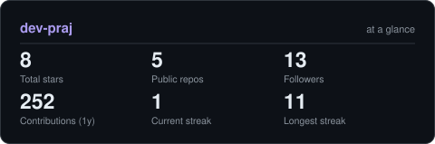

<!-- BANNER - terminal profile.sh --live (additive). Generated by scripts/banner/generate.py.
     ~0.85–0.9 MB each. Cache-bust with ?v=N after regenerating. -->
<picture>
  <source media="(prefers-color-scheme: dark)"  srcset="assets/banner-dark.v9.svg">
  <source media="(prefers-color-scheme: light)" srcset="assets/banner-light.v9.svg">
  
</picture>

 

<!-- NAME / TAGLINE - animated typing -->

 

<!-- CONTACT BADGES -->
&nbsp;&nbsp;
&nbsp;&nbsp;
&nbsp;&nbsp;

 

---

## This is me :)

Hi, I'm **Prajwal**, a **Vibe Coder**.

<!-- - ✨ **One-line bio:** TODO -->

## Contact

- **Contact Email:** [vemalaprajwal8200@gmail.com](mailto:vemalaprajwal8200@gmail.com) 
- **Portfolio 1:** [aboutprajwal.vercel.app](https://aboutprajwal.vercel.app) 
- **Portfolio 2:** [aboutprajwal2.vercel.app](https://aboutprajwal2.vercel.app) 
- **GitHub:** [dev-praj](https://github.com/dev-praj)

<!--
## my perfect stack

TODO: Add confirmed skills and tools.
-->

---

## signals 

<table>
<tr>
<td width="100%" align="center" valign="middle">

<!-- Generated from dev-praj's public GitHub language data by scripts/radar.py -->
<picture>
  <source media="(prefers-color-scheme: dark)"  srcset="assets/radar-langs-dark.svg">
  <source media="(prefers-color-scheme: light)" srcset="assets/radar-langs-light.svg">
  
</picture>

</td>
</tr>
</table>

---

## Numbers matter? ohhh yes. 

<!-- Generated by scripts/cards.py. Contribution tiles require METRICS_TOKEN. Deliberately NOT
     github-readme-stats / streak-stats / github-profile-trophy: those are
     shared public instances that go down and take the whole section with them. -->
<picture>
  <source media="(prefers-color-scheme: dark)"  srcset="assets/card-stats-dark.svg">
  <source media="(prefers-color-scheme: light)" srcset="assets/card-stats-light.svg">
  
</picture>

---

` Build with love· @dev-praj `

